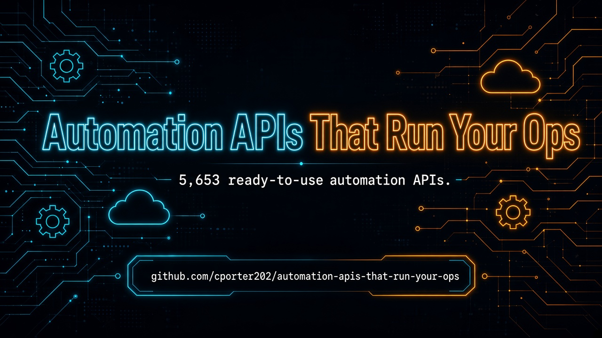

 
 

  <a href="#at-a-glance"><strong>At A Glance</strong></a>
  |
  <a href="#start-here"><strong>Start Here</strong></a>
  |
  <a href="#explore-the-stack"><strong>Explore The Stack</strong></a>
  |
  <a href="#why-this-repo-wins"><strong>Why This Repo Wins</strong></a>
  |
  <a href="#star-history"><strong>Star History</strong></a>

### 🚀 Join My Skool Community

**Want to learn how to vibe code like the pros? Join my Skool community! 🎯**

*I'll show you how to set up applications to use these APIs and start making money! I have the best tech stack when it comes to vibe coding that virtually costs nothing. Forget tools like Loveable, Replit, Manus, Base44, etc.*

 

  <a href="https://www.skool.com/vibe-coding-with-chris-7196" target="_blank" style="display: inline-block; background: #667eea; background-image: linear-gradient(135deg, #667eea 0%, #764ba2 100%); color: #ffffff !important; text-decoration: none !important; padding: 18px 45px; font-size: 18px; font-weight: bold; border-radius: 35px; box-shadow: 0 8px 25px rgba(102, 126, 234, 0.5); letter-spacing: 1px; text-transform: uppercase; border: 2px solid rgba(255, 255, 255, 0.3); cursor: pointer; font-family: -apple-system, BlinkMacSystemFont, 'Segoe UI', Helvetica, Arial, sans-serif;">
    🚀 Join Vibe Coding Community →
  </a>

## At A Glance

> The ultimate collection of automation APIs — workflows, scrapers, notifications, and browser RPA you can put on autopilot. **5,653 production-ready APIs** across **5 navigable sections**.

This repository is designed to feel like a launchpad, not a junk drawer. Pick a section folder, scan the API table, and click through to the provider — no endless flat scrolling.

| Metric | Count |
|--------|-------|
| Total APIs | 5,653 |
| Categories | 5 |
| Last Updated | 2026-09-16 |
| Focus | Ops Automation |

<table>
  <tr>
    <td width="33%" valign="top">
      <h3>Workflow & Orchestration</h3>
      
<strong>596 APIs</strong>

      
Workflow engines, schedulers, zap/make-style automation, and orchestration layers.

      
<a href="./workflow-orchestration/"><strong>Open Workflow & Orchestration Directory</strong></a>

    </td>
    <td width="33%" valign="top">
      <h3>Scrapers & Data Pipelines</h3>
      
<strong>4,379 APIs</strong>

      
Web scrapers, crawlers, ETL helpers, and data pipeline actors.

      
<a href="./scrapers-data-pipelines/"><strong>Open Scrapers & Data Pipelines Directory</strong></a>

    </td>
    <td width="33%" valign="top">
      <h3>Notifications & Integrations</h3>
      
<strong>52 APIs</strong>

      
Slack, email, SMS, webhooks, CRM sync, and third-party integrations.

      
<a href="./notifications-integrations/"><strong>Open Notifications & Integrations Directory</strong></a>

    </td>
  </tr>
  <tr>
    <td width="50%" valign="top">
      <h3>Browser & RPA</h3>
      
<strong>4 APIs</strong>

      
Browser automation, Playwright/Puppeteer bots, form fillers, and RPA.

      
<a href="./browser-rpa/"><strong>Open Browser & RPA Directory</strong></a>

    </td>
    <td width="50%" valign="top">
      <h3>Other Automation Tools</h3>
      
<strong>622 APIs</strong>

      
Everything else that still runs ops — niche bots, utilities, and misc automation APIs.

      
<a href="./other-automation-tools/"><strong>Open Other Automation Tools Directory</strong></a>

    </td>
    <td width="50%"></td>
  </tr>
</table>

## Start Here

1. Pick the section you need first from the cards above.
2. Open that folder's README and scan the API names and descriptions.
3. Click through to the provider page for implementation details, pricing, and docs.
4. Build your shortlist fast instead of wasting hours digging through a flat list.

## Explore The Stack

<strong>Workflow & Orchestration</strong> (596)

Workflow engines, schedulers, zap/make-style automation, and orchestration layers.

- workflow engines
- schedulers / cron jobs
- Zapier / Make style flows
- orchestration layers

[Browse Workflow & Orchestration APIs](./workflow-orchestration/)

<strong>Scrapers & Data Pipelines</strong> (4,379)

Web scrapers, crawlers, ETL helpers, and data pipeline actors.

- web scrapers & crawlers
- ETL / data pipelines
- bulk extractors
- dataset builders

[Browse Scrapers & Data Pipelines APIs](./scrapers-data-pipelines/)

<strong>Notifications & Integrations</strong> (52)

Slack, email, SMS, webhooks, CRM sync, and third-party integrations.

- Slack / Discord / email alerts
- SMS & push notifications
- webhooks & CRM sync
- third-party integrations

[Browse Notifications & Integrations APIs](./notifications-integrations/)

<strong>Browser & RPA</strong> (4)

Browser automation, Playwright/Puppeteer bots, form fillers, and RPA.

- Playwright / Puppeteer bots
- form fillers & click bots
- session / cookie automation
- classic RPA flows

[Browse Browser & RPA APIs](./browser-rpa/)

<strong>Other Automation Tools</strong> (622)

Everything else that still runs ops — niche bots, utilities, and misc automation APIs.

- niche bots
- ops utilities
- monitoring helpers
- misc automation APIs

[Browse Other Automation Tools APIs](./other-automation-tools/)

## Built For

<table>
  <tr>
    <td width="25%" align="center"><strong>Ops Teams</strong></td>
    <td width="25%" align="center"><strong>No-Code Builders</strong></td>
    <td width="25%" align="center"><strong>Agencies</strong></td>
    <td width="25%" align="center"><strong>SaaS Founders</strong></td>
  </tr>
  <tr>
    <td width="25%" align="center"><strong>Growth Hackers</strong></td>
    <td width="25%" align="center"><strong>Data Engineers</strong></td>
    <td width="25%" align="center"><strong>RPA Specialists</strong></td>
    <td width="25%" align="center"><strong>Indie Hackers</strong></td>
  </tr>
</table>

## Why This Repo Wins

- It is opinionated. Sections map to how builders actually search for APIs.
- It is navigable. Top-level folders beat one giant markdown table every time.
- It is faster to use. Jump straight to the category that matches your use case.
- It keeps affiliate tracking intact (`?fpr=p2hrc6`) on every link.
- Custom PNG hero banner — crisp and launch-ready.

## Scope Guarantee

This repository intentionally organizes APIs into:

**Workflow & Orchestration**, **Scrapers & Data Pipelines**, **Notifications & Integrations**, **Browser & RPA**, **Other Automation Tools**

Unmatched rows land in the `other-*` catch-all so **zero APIs are dropped**.

## Follow the Creator

See [FOLLOW_CREATOR.md](./FOLLOW_CREATOR.md) — follow Chris Porter on Facebook for more valuable repos and updates.

## Star History

## Maintenance Notes

- Section classification is keyword-based on API name + description.
- Every original table row is preserved exactly, including affiliate params.
- Visual launchpad layout matches the style of [marketing-apis-that-drive-roi](https://github.com/cporter202/marketing-apis-that-drive-roi).

<!-- AIWITHCHRIS-BANNER-START -->

  

  <a href="https://aiwithchris.com"><strong>🚀 Join my AI Playbook — aiwithchris.com</strong></a> 
  $10/month · 3,600+ prompts · agent workflows · repo breakdowns · money ideas

<!-- AIWITHCHRIS-BANNER-END -->

